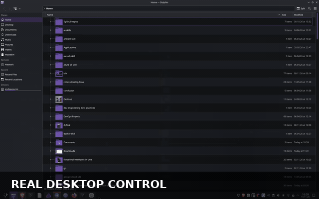

# Desktop Control MCP

**Give your AI agent hands-on control of a real desktop.**

Desktop Control MCP is a public Model Context Protocol (MCP) project that lets AI agents see and interact with your computer: take screenshots, move the mouse, click, type, open apps, and manage windows.

One consistent set of MCP tools. Native desktop integration across **Linux, Windows, and macOS**.

<p align="center">
  <a href="https://github.com/oludayoadeoye/linux-desktop-mcp/releases/latest"></a>
  <a href="https://github.com/oludayoadeoye/linux-desktop-mcp/actions/workflows/ci.yml"></a>
  <a href="https://github.com/oludayoadeoye/linux-desktop-mcp/stargazers"></a>
</p>

<p align="center">
  <a href="https://github.com/oludayoadeoye/linux-desktop-mcp/releases/latest"><strong>⬇ Download</strong></a> ·
  <a href="https://github.com/oludayoadeoye/linux-desktop-mcp/releases"><strong>Releases</strong></a> ·
  <a href="https://oludayoadeoye.github.io/linux-desktop-mcp/"><strong>Documentation site</strong></a> ·
  <a href="docs/INSTALL.md"><strong>Installation guide</strong></a> ·
  <a href="#live-demo"><strong>Live demo</strong></a>
</p>

---

## What can it do?

Your agent can work with the desktop instead of only talking about it.

| Your agent can… | What that means |
|---|---|
| 👀 **See the screen** | Capture a screenshot and inspect what's visible |
| 🖱️ **Use the mouse** | Move, click, and interact with on-screen controls |
| ⌨️ **Type for you** | Enter text and send keyboard shortcuts |
| 🚀 **Open applications** | Launch supported desktop applications |
| 🪟 **Manage windows** | List, focus, switch, minimize, maximize, restore, and close windows |
| 🌐 **Use a browser** | Navigate pages and interact with browser elements through the Playwright MCP sidecar |

## Live demo

This 13-second clip shows the MCP server interacting with a real EndeavourOS desktop: navigating project files and managing application windows.

<p align="center">
  <a href="docs/media/desktop-control-demo.mp4"></a>
</p>

<p align="center">
  <a href="docs/media/desktop-control-demo.mp4"><strong>▶ Watch the MP4 demo</strong></a>
</p>

The clip demonstrates Linux desktop interaction. It is not a claim that every tool or every operating-system backend has been physically tested.

## Get started

Choose the installation that matches your computer. The standalone downloads are ready to run; the full Linux setup also configures the KDE/Wayland integration and supporting services.

### Linux

**Fast install — Linux x86_64 and ARM64**

Open a terminal and run:

```bash
curl -fsSL https://raw.githubusercontent.com/oludayoadeoye/linux-desktop-mcp/master/install.sh | bash
```

Then check the installation:

```bash
desktop-control-mcp status
```

**EndeavourOS / Arch Linux — full desktop integration**

For KDE Plasma on Wayland, install the complete stack (desktop MCP, KWin bridge, and Playwright browser sidecar):

```bash
git clone https://github.com/oludayoadeoye/linux-desktop-mcp.git
cd linux-desktop-mcp
./scripts/install-arch.sh
```

Log out and back into KDE after installation so KWin can load its script package. See the [Arch and Linux installation guide](docs/INSTALL.md).

### Windows

1. Download **desktop-control-mcp-windows-x86_64.exe** from [GitHub Releases](https://github.com/oludayoadeoye/linux-desktop-mcp/releases/latest).
2. Download `SHA256SUMS` and verify the executable in PowerShell:

```powershell
Get-FileHash .\\desktop-control-mcp-windows-x86_64.exe -Algorithm SHA256
```

3. Compare the hash with the matching entry in `SHA256SUMS`, rename the verified file to `desktop-control-mcp.exe`, and place it in a folder on your PATH.

Run it from your signed-in Windows desktop session. A Windows service in Session 0 cannot interact with your visible desktop.

### macOS

Download the matching **Intel** or **Apple Silicon** executable from [GitHub Releases](https://github.com/oludayoadeoye/linux-desktop-mcp/releases/latest), then:

```bash
chmod +x ./desktop-control-mcp-macos-arm64
./desktop-control-mcp-macos-arm64 --help
```

Use the Intel asset on Intel Macs. On first use, grant the terminal or agent host **Accessibility** and **Screen Recording** permissions in System Settings → Privacy & Security.

> **macOS note:** Release binaries are currently unsigned and not notarized. Verify the checksum before running; macOS may ask you to approve the executable. The macOS backend has CI/unit-test coverage but still needs validation on a physical Mac.

## Downloads

Every tagged release publishes five standalone executables and one SHA-256 checksum manifest.

| Download | Supported system |
|---|---|
| `desktop-control-mcp-linux-x86_64` | Linux 64-bit Intel / AMD |
| `desktop-control-mcp-linux-aarch64` | Linux ARM64 |
| `desktop-control-mcp-windows-x86_64.exe` | Windows 10/11, 64-bit |
| `desktop-control-mcp-macos-x86_64` | macOS, Intel |
| `desktop-control-mcp-macos-arm64` | macOS, Apple Silicon |
| `SHA256SUMS` | Checksums for all five downloads |

**[Get the latest release →](https://github.com/oludayoadeoye/linux-desktop-mcp/releases/latest)**

**Using EndeavourOS or Arch?** Download the Linux binary that matches your CPU. There is no separate Arch binary. The standalone executable contains the Python application, while the full desktop experience still relies on system components such as KDE/Wayland, D-Bus, ydotool, the KWin bridge, and Playwright/Firefox. The Arch installer configures those supporting services.

## How it works

Desktop Control MCP is the bridge between an AI agent and the operating system:

1. **The agent asks** to see the screen or perform an action.
2. **The MCP server receives** the tool call.
3. **The native backend acts** on the active desktop using the platform's supported APIs.
4. **The result returns** to the agent so it can decide what to do next.

```text
AI agent  ⇄  MCP tools  ⇄  Desktop Control MCP  ⇄  Your desktop
                                            ├── Linux (KDE / Wayland)
                                            ├── Windows (Win32)
                                            └── macOS (Quartz / Accessibility)
```

The project exposes **19 MCP tools** with a consistent interface across supported platforms. Browser automation is provided through a separate Playwright MCP sidecar.

## Connect an MCP client

The server supports **stdio** (recommended when an agent launches the server) and **Streamable HTTP** (for a local service integration).

Start with stdio:

```bash
desktop-control-mcp serve --transport stdio
```

Or run a local HTTP endpoint:

```bash
desktop-control-mcp serve --transport http --host 127.0.0.1 --port 8932
```

For a full EndeavourOS/Arch setup, the installer configures the supporting services and local endpoint. Follow the [installation guide](docs/INSTALL.md) for client configuration and runtime requirements.

## Platform support

| Platform | Backend | Build / CI | Real desktop validation |
|---|---|---:|---|
| Linux KDE / Wayland | KWin, D-Bus, ydotool, Spectacle | ✅ | ✅ EndeavourOS |
| Windows x64 | Win32 + PyAutoGUI | ✅ | Pending physical Windows test |
| macOS Intel | Quartz + Accessibility | ✅ | Pending physical Mac test |
| macOS Apple Silicon | Quartz + Accessibility | ✅ | Pending physical Mac test |

Build and CI success confirms packaging and automated tests; it does not replace testing on each physical operating system. macOS and Windows interactive validation is still on the project roadmap.

## Development

Requires Python 3.11+ and [uv](https://docs.astral.sh/uv/).

```bash
git clone https://github.com/oludayoadeoye/linux-desktop-mcp.git
cd linux-desktop-mcp
uv sync --locked --group dev
uv run ruff check .
uv run pytest -q
```

Build a standalone executable on the target operating system and CPU architecture:

```bash
uv sync --locked --group build
uv run pyinstaller --clean --noconfirm --onefile --name desktop-control-mcp --collect-all mcp --collect-all pydantic --collect-submodules backends cli.py
```

GitHub Actions runs linting, automated tests, platform builds, and smoke tests for release artifacts.

## Security

Desktop automation is powerful. Treat it like giving an agent access to your keyboard and mouse.

- The HTTP endpoint binds to `127.0.0.1` by default. Do not expose it directly to the public internet.
- Connect only MCP clients you trust.
- Application launching is restricted by an allowlist where supported.
- Review the actions your agent is asked to perform, especially actions involving accounts, files, or payments.

## Contributing

Issues, bug reports, ideas, and pull requests are welcome. If you test the project on a different Linux distribution, Windows PC, or Mac, please share your platform details and what worked.

Before contributing, please read the project rules:

- [Contributor guide](CONTRIBUTING.md) — setup, architecture, tests, and pull request process.
- [AI agent instructions](AGENTS.md) — strict scope, safety, and maintainability rules for coding agents and bots.
- [Pull request checklist](.github/pull_request_template.md) — required validation and review details.

**The most important rule:** make small, tested, explainable changes. Avoid broad rewrites, unrelated refactoring, unnecessary dependencies, and claims that have not been verified.

- **Report a bug:** [Open an issue](https://github.com/oludayoadeoye/linux-desktop-mcp/issues)
- **Suggest an idea:** [Start a discussion](https://github.com/oludayoadeoye/linux-desktop-mcp/discussions)
- **Source code:** [GitHub repository](https://github.com/oludayoadeoye/linux-desktop-mcp)

## License

The repository is public, but it does not yet include a license file. Until a license is published, no permission to reuse, modify, or redistribute the code is granted.
